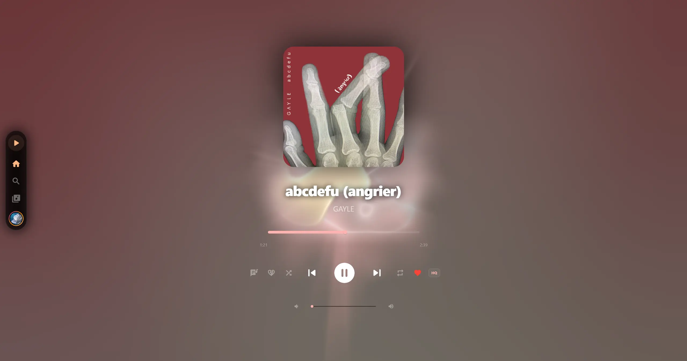
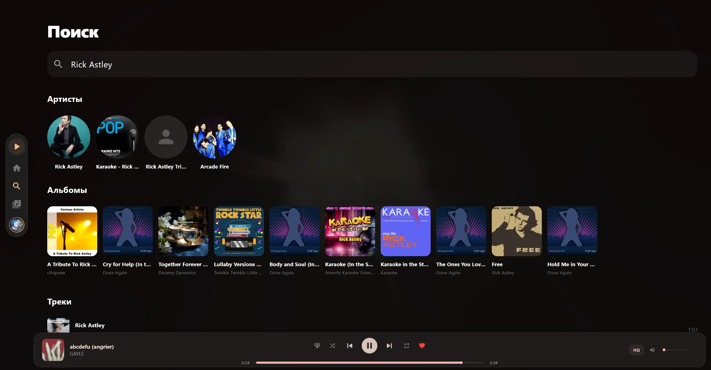
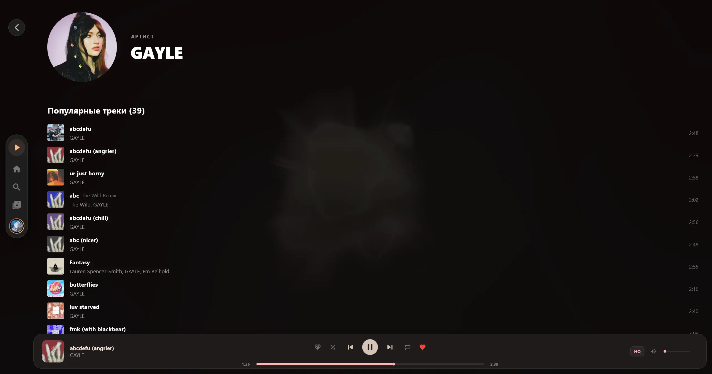

#  YAYMA (Yet Another Yandex Music App)

Альтернативный клиент для Яндекс Музыки

<table>
  <tr>
    <td align="center"></td>
    <td align="center"></td>
    <td align="center"></td>
  </tr>
</table>

## Предупреждение

**YAYMA** - неофициальный клиент для личного использования. Он не связан с «Яндексом» и **не одобрен** им; названия и товарные знаки принадлежат их владельцам. Используется API, не предназначенное для публичного использования, поэтому за соблюдение правил сервиса и риск блокировки аккаунта отвечаете вы.

## Возможности

- **Приватность**: никакой аналитики не нужной для музыки
- **Тексты песен**: несколько источников (LrcLib, LrcMux, BetterLyrics), включая пословную синхронизацию
- **Интеграция с системой**: управление из панели задач Windows, Discord Rich Presence, глобальные горячие клавиши

## Лицензия

Проект распространяется под лицензией [GPL-3.0](LICENSE).

